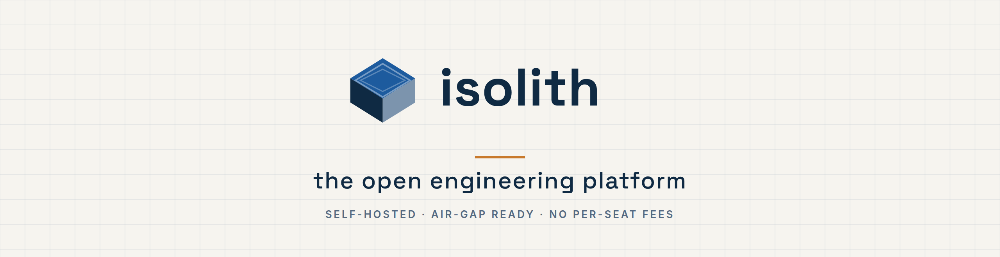
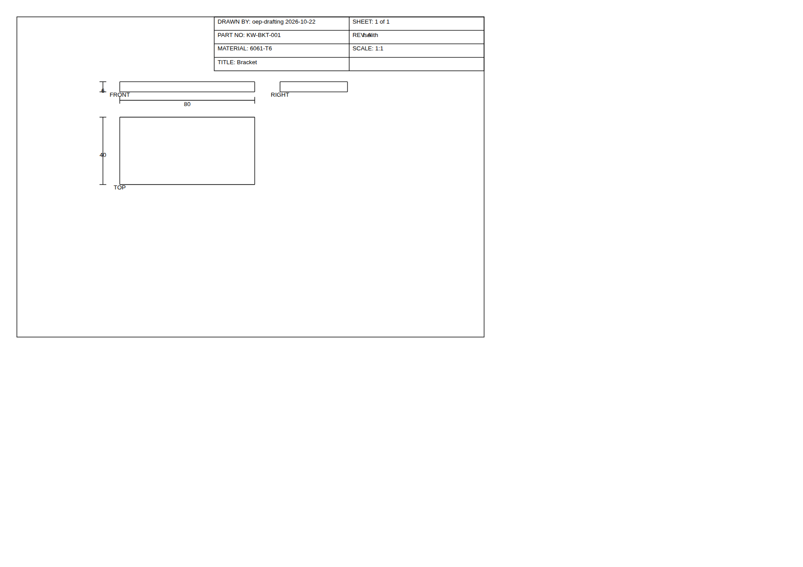
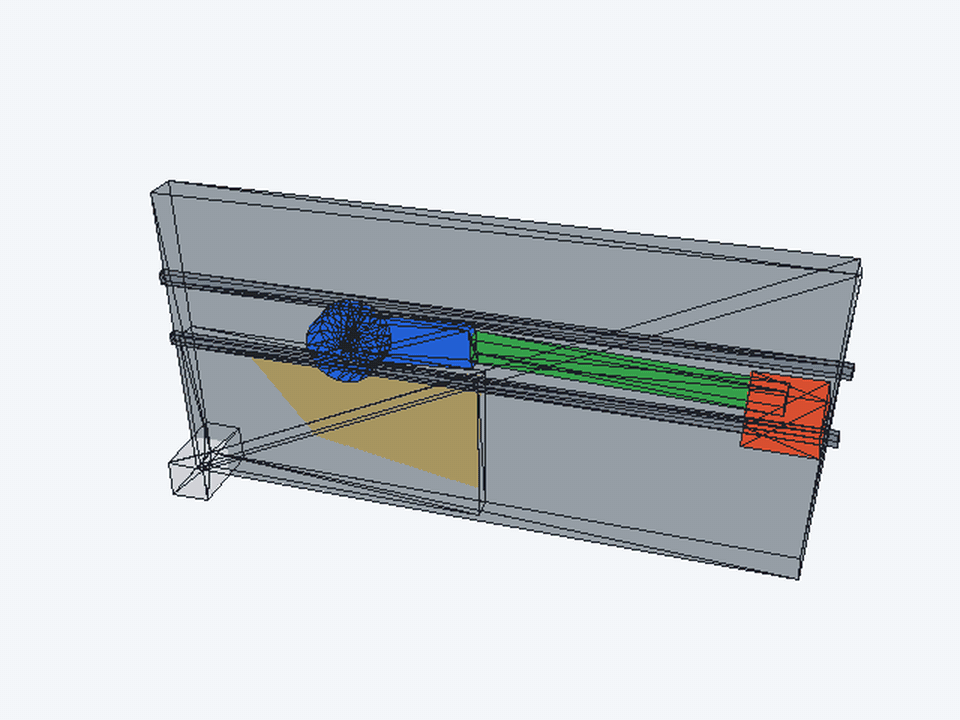
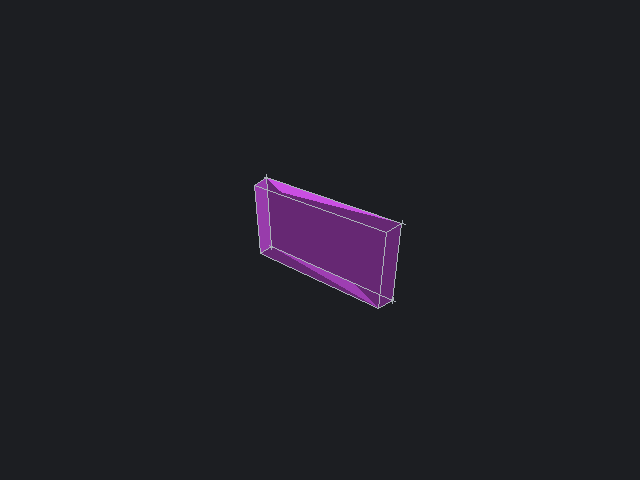
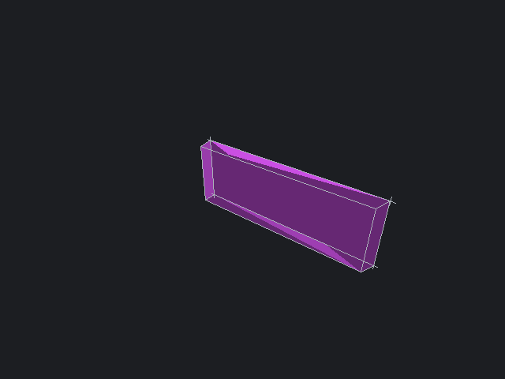

<p align="center">
  
</p>

<p align="center">
  <a href="https://github.com/isolith-project/isolith/actions/workflows/ci.yaml"></a>
  
  
  
</p>

<p align="center">
  <strong>Open-source engineering design that runs inside your own network.</strong><br>
  Sketch, model, assemble, draft, and manage the data, with no subscriptions, no per-seat
  fees, and no forced cloud account.
</p>

Isolith is an engineering design program: the everyday job of professional CAD, built in
the open. You draw a sketch, constrain it, drive a dimension with a named variable, and
watch the solid recompute. You mate parts into an assembly, play the mechanism, and turn
the result into a drawing with a title block.

The software and the design data stay on machines you control. Isolith runs inside your own
network and works fully air-gapped, which is the only reason a team handling
export-controlled models can consider new CAD at all.

It also opens the files engineers actually receive: STEP, CATIA CGR and 3DXML, and it pulls
geometry out of native CATPart files. Underneath sits a real geometry kernel (Open CASCADE
behind the vendor-neutral `oep-geo` seam), a self-hosted PDM with roles and audit, and a
peer-to-peer compute lane for render and convert work.

## Status

Pre-release. The 2027.1 train is the interop/PDM foundation release; the editor is the
product spine. That foundation ships with published checksums and a signed release manifest
you can verify: readers, geometry core, vault, compute, delivery, and a documentation site.
Windows installers are not Authenticode-signed yet, so SmartScreen warns on first run; check
the checksum, then allow the file. The editor is new. Sketches, constraints, extrude and
revolve, fillet and chamfer, assemblies, drawings, and measurement run today on real
geometry; closing the gap in breadth against mature CAD is the work in front of us. Expect
behavior to change before general availability.

The limits are written down rather than implied:
[what it does not do](docs-site/what-it-does-not-do.html) and the
[format capability matrix](docs-site/format-matrix.html) state what each reader opens and at
what fidelity.

## Quick start

Two ways to run the whole stack (PDM, viewer, compute dashboard, docs site): as containers,
or from source. Docker Compose and about 2 GB of disk cover the container path.

```sh
git clone https://github.com/isolith-project/isolith.git
cd isolith/workstreams/delivery/deploy/deploy
./install.sh
```

`install.sh` preflights the host, builds or loads the stack image, waits for every health
check to turn green, then prints the operator summary. For an air-gapped target, build the
bundle on a connected machine first:

```sh
./install.sh --offline-bundle isolith-oep-stack-0.1.0.tar.gz
./install.sh --down          # stop the stack
```

From source, with Rust 1.98.1 pinned by `rust-toolchain.toml`:

```sh
cargo build --release
./target/release/isolith     # the editor
./target/release/oep-pdm     # REST API on http://127.0.0.1:8787
./target/release/oep-docs    # docs site on http://127.0.0.1:8792
```

Every bind is `127.0.0.1` by default. Nothing reaches the LAN until an operator publishes a
port, and no component phones home.

## See it working

Each image below is a capture from the running software. The
[media manifest](docs-site/assets/media-manifest.md) records what produced every one of
them, on which commit. This is a young editor surface, so the captures show what it
actually produces.

<p align="center">
  
</p>

Drafting output from `oep-drafting`: a 1:1 sheet with a title block (part, material, scale)
and top, front, and right views carrying dimensions, exported to PDF or SVG.

<p align="center">
  
</p>

A mechanism motion study, every frame solved by the constraint solver in `oep-kinematics`.
The full clip is
[`04-mechanism-animation.mp4`](docs-site/assets/images/04-mechanism-animation.mp4), and a
[contact sheet](docs-site/assets/images/06-mechanism-contact-sheet.png) shows nine poses.

<table>
<tr>
<td align="center"><br><sub>before a driven dimension change</sub></td>
<td align="center"><br><sub>after, same model, live recompute</sub></td>
</tr>
</table>

Change the variable and the solid updates, which is why this one is a pair. These are 640x480
viewport rasters taken straight from the editor, with no anti-aliasing and no window chrome.

## What you can do

| Area | What works today |
| --- | --- |
| Read | STEP AP242 with semantic PMI, CGR triangle tessellation, 3DXML, and geometry extracted from native CATPart. QIF and JT come next. |
| Design | 2D sketch with constraints and dimensions, variables that drive the model, extrude, revolve, fillet, chamfer, boolean add and subtract, undo. |
| Assemble | Coincident, on-plane, plane-distance, and parallel mates, mechanism motion, assembly tree. |
| Draft | Projected views, dimensions, title block, export to PDF, SVG, and STEP. |
| Check | Mass properties, center of gravity, interference, exploded views. |
| Manage | Self-hosted vault with revisions, roles, and audit on REST API v1, authorized by default. |
| Compute | Job queue plus sandboxed render and convert workers, with outputs checked back into the vault. |
| Automate | Every editor command is also a CLI call, so scripts and agents drive the same work. |

## Repository layout

| Path | What lives there |
| --- | --- |
| `crates/` | One crate per subsystem: `oep-app` (editor shell), `oep-geo` (geometry seam), `oep-engine-occ` (kernel binding), the readers, `oep-pdm`, `oep-drafting`, `oep-shell`, and the rest. |
| `workstreams/` | Design records, decision notes, and the proof transcripts behind each lane. |
| `docs-site/` | The documentation site the delivery stack serves, with its media and provenance manifest. |
| `docs/` | Layout map, licensing boundary, scope register, format and competitive records. |
| `tests/`, `python/`, `xtask/` | Workspace acceptance tests, Python tooling, build tasks. |
| `assets/brand/` | Identity kit: mark, palette, type, usage rules. |

The full mapping is in [`docs/layout.md`](docs/layout.md).

## Build and test

```sh
cargo build --workspace
cargo test --workspace
uv run pytest tests/
```

The quality gate adds formatting, clippy, the license boundary check, and the docs site
gate:

```sh
bash scripts/gate/precommit-gate.sh
```

CI runs those checks on every pull request. The heavier GA gates (format fidelity, PDM
multi-user cycle, 100-job compute wave, install rehearsal) run on release tags.

## Documentation

After `install.sh`, the docs site is at `http://127.0.0.1:8792`. The sources ship in this
repository:

| Page | Source |
| --- | --- |
| Getting started: the eight-step verified install | [`docs-site/getting-started.html`](docs-site/getting-started.html) |
| Admin guide: online and air-gap paths, TLS, backup, recovery | [`docs-site/admin-guide.html`](docs-site/admin-guide.html) |
| Format capability matrix | [`docs-site/format-matrix.html`](docs-site/format-matrix.html) |
| What it does not do | [`docs-site/what-it-does-not-do.html`](docs-site/what-it-does-not-do.html) |
| License boundary | [`docs-site/license.html`](docs-site/license.html) |
| Security posture | [`docs-site/security.html`](docs-site/security.html) |
| Releases and changelog | [`docs-site/releases.html`](docs-site/releases.html) |
| Download, checksums, and the SmartScreen note | [`docs-site/download.html`](docs-site/download.html) |
| Competitive parity matrix (2026-10) | [`docs/competitive/parity-2026-10.md`](docs/competitive/parity-2026-10.md) |

## License

Hybrid, per crate: Apache-2.0 for applications and libraries, AGPL-3.0 for the server, the
PDM, and the P2P orchestration components. The texts are at the repository root
([`LICENSE-APACHE`](LICENSE-APACHE), [`LICENSE-AGPL`](LICENSE-AGPL)) with a short index in
[`LICENSE`](LICENSE); the boundary is mapped in
[`docs/licensing-boundary.md`](docs/licensing-boundary.md) and enforced in CI by
`scripts/licensing-check.py`. Third-party attribution is generated from the committed
`Cargo.lock` into [`NOTICE`](NOTICE). Exports are classified per release.

## Contributing

Contributions are welcome under the DCO, and the check enforces the sign-off. Start with
[`CONTRIBUTING.md`](CONTRIBUTING.md), then [`GOVERNANCE.md`](GOVERNANCE.md) and the
[`CODE_OF_CONDUCT.md`](CODE_OF_CONDUCT.md). Report vulnerabilities through GitHub private
vulnerability reporting, described in [`SECURITY.md`](SECURITY.md). The program charter is
[`charter.md`](charter.md).
